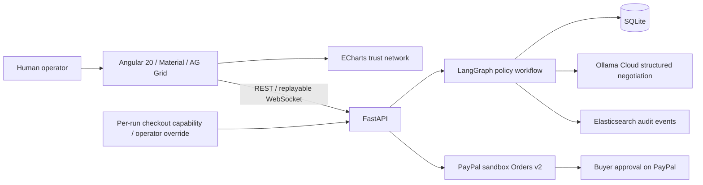
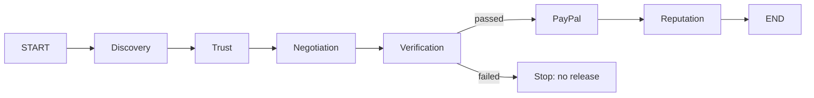

# Architecture

## System



Frontend and API are deployed on the same origin. The UI always uses sandbox checkout, which requires FastAPI. A server run never silently falls back to a second browser flow.

The optional rogue-agent exercise is an isolated browser-side scenario with a fixed price-change attempt and a deterministic governance report. It does not call the backend, execute agent-supplied instructions, or modify transaction, payment or reputation data.

## LangGraph



The graph state contains `run_id`, `task`, `budget`, candidates, selected agent, agreed price, verified and paid. Six node functions are the six agents; the fixed demo service delivers the SVG at verification. A conditional edge prevents entering the PayPal node if verification fails. PayPal also reads the persisted verification result, so a forged graph flag alone is insufficient to release simulated funds. Reputation requires settlement and a unique transaction reference.

Negotiation locks the fixed contract price. In demo mode the PayPal node releases simulated funds and reputation updates immediately. In sandbox mode it records `awaiting_approval` without moving funds or increasing reputation. The UI then automatically creates the sandbox order using a per-run checkout capability; each PayPal step is appended to the run events and indexed in Elasticsearch. Before authorization, the server fetches the order from PayPal and checks buyer approval, order ID, run ID and exact USD amount. Authorization and capture amounts are also checked. Only completed capture records sandbox reputation, in the same SQL transaction as the persisted capture; repeat requests return the cached result.

## Trust Policy

```text
trust = 0.45 * reliability
      + 0.25 * experience
      + 0.20 * dispute_record
      + 0.10 * identity

reliability   = clamp(success_percent, 0, 100)
experience   = 100 * completed_jobs / (completed_jobs + 50)
dispute_record = max(0, 100 - 2000 * disputes / max(1, completed_jobs))
identity     = 100 if verified, otherwise 0
```

Discovery returns four seeded service agents; Trust chooses the highest deterministic score above 85 that fits the budget. The UI's initial published reputation scores are sample registry values; persisted trust calculations include exact factors per candidate and run. After verified settlement (simulated release for demo, completed PayPal capture for sandbox), published reputation increases by 0.2, capped at 99.9. This simple prototype policy is not a calibrated fraud model. Amounts use Decimal/Numeric with USD and a $1,000 per-task maximum.

## Database Schema

The executable source of truth is SQLAlchemy metadata in `backend/database.py`; startup creates missing tables and seeds missing agents. Existing schemas are not migrated automatically. The local and Render deployments use SQLite.

| Table | Columns |
| --- | --- |
| `agents` | `id varchar(40) PK`, `name varchar(100)`, `role varchar(100)`, `trust float`, `success float`, `jobs int`, `disputes int`, `price numeric(12,2)`, `identity_verified boolean` |
| `transactions` | `id varchar(36) PK`, `agent_id FK agents`, `task text`, `budget numeric(12,2)`, `value numeric(12,2)`, `status varchar(30)`, `mode varchar(20)`, `delivery float`, `trust float`, `events json`, `payment json`, `error text`, `created_at varchar(40)` |
| `trust_scores` | `id PK`, `agent_id FK agents`, `transaction_id FK transactions`, `score float`, `factors json`, `created_at varchar(40)` |
| `negotiations` | `id PK`, `transaction_id UNIQUE FK transactions`, `agent_id FK agents`, `proposal numeric(12,2)`, `agreed numeric(12,2)`, `turns json`, `model varchar(100)` |
| `verification_results` | `id PK`, `transaction_id UNIQUE FK transactions`, `verifier_id FK agents`, `passed boolean`, `score float`, `checks json`, `artifact text` |
| `reputation_history` | `id PK`, `transaction_id UNIQUE FK transactions`, `agent_id FK agents`, `before float`, `after float`, `reason text`, `created_at varchar(40)` |
| `checkout_sessions` | `transaction_id PK FK transactions`, `token_hash varchar(64)`, `expires_at float` |

IDs are generated UUIDs except stable registry agent IDs. Timestamps are UTC ISO-8601 strings. The unique transaction constraints prevent duplicate negotiation, verification and reputation outcomes. SQLite is used with a single worker and a single application instance; it is not intended for horizontal scaling.

## REST APIs

| Method | Path | Purpose |
| --- | --- | --- |
| GET | `/api/health` | database readiness, configured engine/provider modes |
| GET | `/api/agents` | current registry |
| POST | `/api/runs` | start logo mission: `{task, budget, payment_mode: "demo" or "sandbox"}`; defaults to sandbox when PayPal credentials are configured, otherwise demo; returns ID and sandbox-only checkout token |
| GET | `/api/runs/{id}` | durable state, full events, transaction projection, error |
| GET | `/api/runs/{id}/artifact` | SVG attachment |
| GET | `/api/transactions` | latest 200 backend transactions |
| GET | `/api/agents/{id}/reputation` | latest 100 reputation changes |
| GET | `/api/events/search?q=...&run_id=...` | up to 50 Elasticsearch audit events; optional UUID run filter |
| GET | `/api/paypal/{id}` | authenticated sanitized checkout status, approval URL and payment references |
| POST | `/api/paypal/{id}/order` | authenticated sandbox AUTHORIZE order |
| POST | `/api/paypal/{id}/authorize` | authorize an already buyer-approved order |
| POST | `/api/paypal/{id}/capture` | capture only a verified authorized contract |

OpenAPI lives at `/docs`. Validation returns 422; missing runs 404; policy conflicts 409; capacity 429; sandbox configuration 503; provider errors 502. A maximum of six concurrent demo runs bounds in-process work. This is not a replacement for ingress-level distributed rate limiting.

## WebSocket Event Model

Connect to `/api/ws/{run_id}`. Existing persisted events are replayed from sequence 1, then new events are sent in order. The client deduplicates by sequence. If disconnected it reads `/api/runs/{id}` until terminal status, avoiding a second run.

```json
{
  "type": "event",
  "run_id": "8accd9a1-9aa4-402b-80f7-81ca51a5ab88",
  "sequence": 7,
  "stage": 3,
  "agent": "Verification Agent",
  "message": "Sentinel is independently checking the demo SVG artifact.",
  "time": "2026-11-09T12:00:00+00:00"
}
```

Stage indexes: 0 Discover, 1 Trust, 2 Negotiate, 3 Verify, 4 Pay, 5 Reputation. Terminal messages are `{type: "complete", transaction: {...}}` or `{type: "error", message: "..."}`. Events are committed before publication. No credentials enter events. WebSocket connections are read-only and use unguessable run IDs; tenant-scoped authentication remains a production prerequisite.

## Ollama Cloud

`POST https://ollama.com/api/chat` uses a server-only bearer key, configurable `OLLAMA_MODEL` (default `gpt-oss:120b`), and `stream: false`. A JSON schema generated from `NegotiatedOffer` is supplied in the system prompt. The Cloud endpoint does not support the local API's structured-output `format` parameter, so the server validates returned JSON itself. Exact six-role prompts are in `backend/integrations.py` under `PROMPTS`.

Only Negotiation calls the model. Its system prompt limits output to a fixed-price SVG contract and treats task text as untrusted data. Pydantic checks structure, bounds, and rationale length. Application code independently checks exact contract price and budget. Invalid output, network errors or the configured timeout (90 seconds by default) fail the run visibly; no demo offer substitutes for a configured model. Missing credentials produce an explicitly labeled `deterministic-demo`. The rationale and actual model are recorded in SQL and the event feed. Other role prompts are extension points, not additional model calls.

## Elasticsearch

Each workflow event is sent to `nexus-events-v1` with document ID `{run_id}:{sequence}`. This makes repeated indexing replace the same record. `ELASTICSEARCH_URL` and `ELASTICSEARCH_API_KEY` configure the external cluster. TLS verification remains enabled. A two-second timeout and no retries isolate logging outages; events are also retained in SQL. The transaction center calls `/api/events/search` to search agent names and messages, returning at most 50 events ordered by time and sequence. The API also supports an optional UUID run filter. Search failures return explicit errors, not SQL fallback results. Failed indexing is logged but not automatically replayed; a production outbox should replay committed SQL events.

## Governance And Security

- Models cannot execute payments or override deterministic policy.
- Producer and verifier must be distinct; structural checks are insufficient for real creative acceptance.
- Sandbox operations require a random per-run capability or optional server-configured operator token, compared in constant time. Only a SHA-256 capability hash is stored server-side; capabilities expire after 24 hours.
- Provider credentials never enter Angular, browser storage or logs. Only the per-run checkout capability is held in session storage. The PayPal host and allowed buyer-approval URL host are hardcoded to sandbox.
- Stable provider idempotency keys and cached results protect retry paths. The implementation uses one worker and per-run async locks; multi-worker deployments require durable payment-operation locks and reconciliation.
- No real funds, custody, escrow licensing, identity verification service or dispute adjudication is claimed.
- Before production: OIDC/RBAC, row-level tenant authorization, signed agent identities, durable queue/checkpointer, webhook verification, reconciliation, schema migrations, budget approvals and an independent security/compliance review.